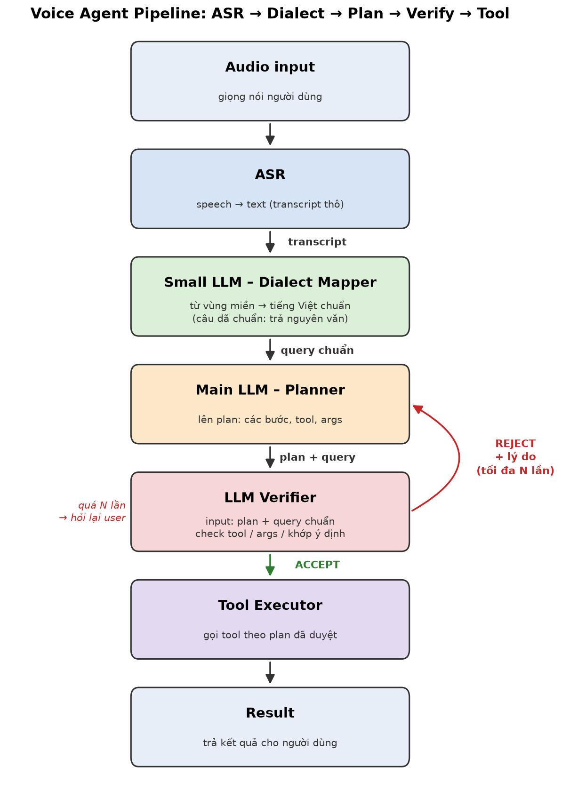
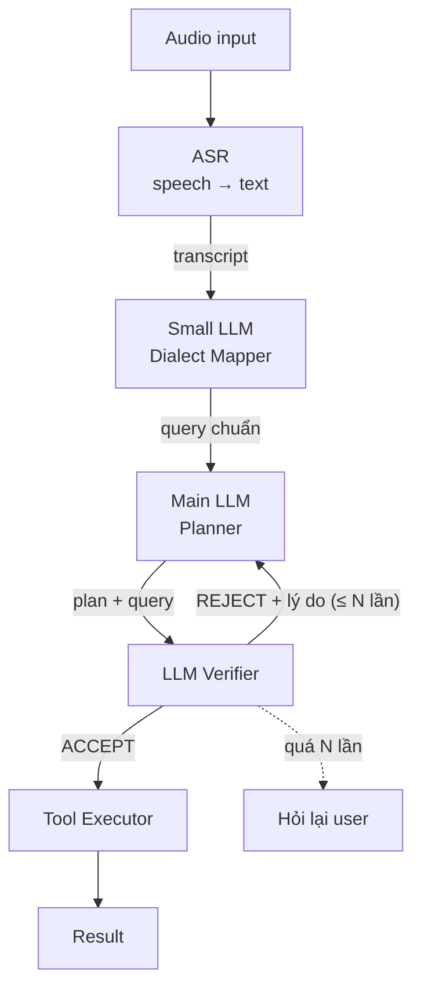

# Voice Agent Pipeline

Pipeline xử lý yêu cầu bằng giọng nói: **ASR → Chuẩn hoá phương ngữ → Lập plan → Verify → Gọi tool**.





---

## 1. Tổng quan luồng

| # | Bước | Input | Output | Model |
|---|------|-------|--------|-------|
| 1 | ASR | Audio | Transcript thô | Whisper / model ASR tiếng Việt |
| 2 | Dialect Mapper | Transcript thô | Query tiếng Việt chuẩn | Small LLM |
| 3 | Planner | Query chuẩn | Plan (các bước, tool, args) | Main LLM |
| 4 | Verifier | Plan + query chuẩn | `ACCEPT` / `REJECT` + lý do | LLM (cùng hoặc khác Main LLM) |
| 5 | Tool Executor | Plan đã ACCEPT | Kết quả tool | Code (không phải LLM) |

---

## 2. Chi tiết từng bước

### 2.1 ASR (Automatic Speech Recognition)

ASR chuyển giọng nói thành văn bản, giữ nguyên cách nói của người dùng kể cả từ địa phương.

- Output là transcript thô, có thể lẫn từ vùng miền và lỗi nhận dạng.
- Không chuẩn hoá ở bước này, để Dialect Mapper xử lý tập trung.

### 2.2 Small LLM – Dialect Mapper

Small LLM chuyển từ ngữ vùng miền sang tiếng Việt chuẩn mà không đổi ý nghĩa câu.

- Câu đã chuẩn thì **trả nguyên văn**, nên không cần thêm bước classifier "có phương ngữ hay không".
- Dùng model nhỏ vì đây là tác vụ rewrite đơn giản, cần nhanh và rẻ.
- Chỉ được đổi từ ngữ, không được thêm hay bớt ý (tên riêng, số, ngày giờ phải giữ nguyên).

Ví dụ:

| Transcript thô | Query chuẩn |
|---|---|
| "Mai mấy giờ tàu ra Huế rứa?" | "Ngày mai mấy giờ có tàu ra Huế vậy?" |
| "Đặt cho tui cái lịch họp chiều ni" | "Đặt cho tôi lịch họp chiều nay" |
| "Bật đèn phòng khách" | "Bật đèn phòng khách" *(giữ nguyên)* |

### 2.3 Main LLM – Planner

Main LLM đọc query chuẩn cùng danh sách tool có sẵn rồi lập plan gồm các bước, tool cần gọi và tham số.

Output nên là JSON để Verifier và Executor parse được:

```json
{
  "intent": "tra cứu lịch tàu",
  "steps": [
    {"tool": "search_train", "args": {"to": "Huế", "date": "2026-11-01"}}
  ]
}
```

Khi nhận REJECT, Planner dùng **lý do reject** để sửa plan, không lập lại từ đầu.

### 2.4 LLM Verifier

Verifier nhận **plan + query chuẩn** và kiểm tra plan trước khi cho phép gọi tool.

Các điểm cần check:
1. **Đúng tool:** tool có tồn tại và có phù hợp với ý định của query không.
2. **Đúng args:** đủ tham số bắt buộc, đúng kiểu, giá trị khớp với query (ngày, tên, số).
3. **Khớp ý định:** plan làm đúng việc user yêu cầu, không thừa và không thiếu.
4. **An toàn:** hành động không đảo ngược được (xoá, thanh toán, gửi tin) thì cần user xác nhận.

Output:

```json
{"verdict": "REJECT", "reason": "thiếu args 'date', query nói 'ngày mai'"}
```

### 2.5 Tool Executor

Dựa trên ToolEnv của Ban Tổ Chức
---

## 3. Vòng lặp REJECT

Sau khi Verifier REJECT, plan quay về Planner kèm lý do, **tối đa N lần** (gợi ý N = 2–3).

- Không giới hạn số vòng thì Planner và Verifier có thể lặp mãi, tốn token và tăng độ trễ.
- Quá N lần thì dừng lại và **hỏi lại user** (thường do query mơ hồ hoặc thiếu thông tin).

```
Planner ──plan──► Verifier ──REJECT + lý do──► Planner   (retry ≤ N)
                     │
                     ├── ACCEPT ──► Tool Executor
                     └── quá N lần ──► hỏi lại user
```

---
