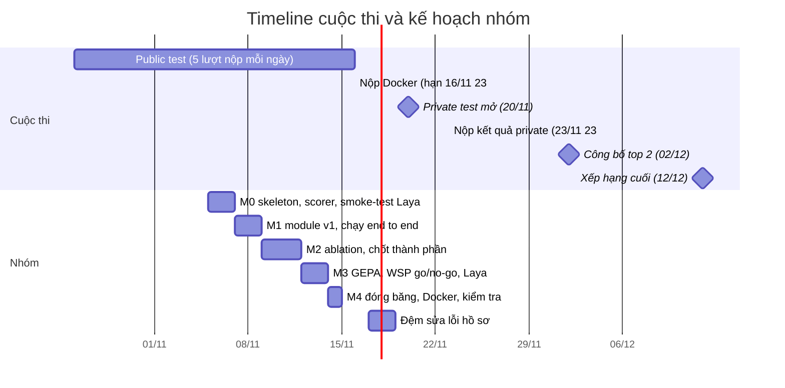
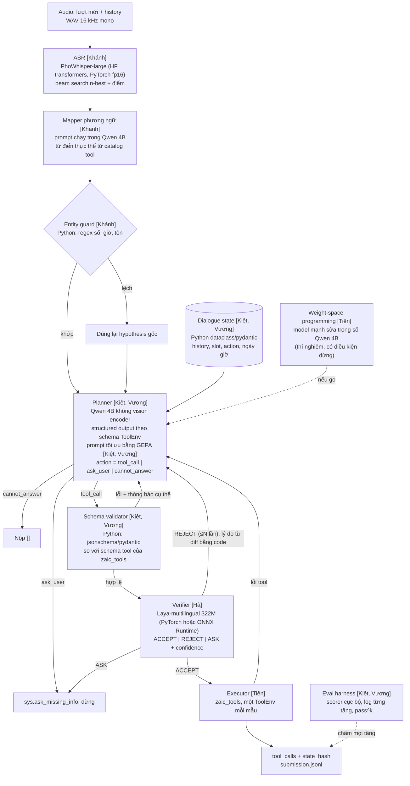

# ZAIC 2026 LifeMate: Tổng quan dự án, kiến trúc và cấu trúc repo

Cập nhật 05/11/2026. Nguồn pipeline: `PIPELINE.md` (plan cũ) và `New_plan.md` (plan mới).

> **Giả định trong tài liệu này (cần xác nhận, xem mục 9)**
> a. Luật LifeMate lấy từ hai repo tóm tắt của thí sinh khác (lenamkhanhh/ZaloAIC, Nguyen-Le-Tuan/ZAIC_2026), chưa đọc được portal chính thức. Mốc thời gian đã đối chiếu với challenge.zalo.ai (05/11). Giới hạn tham số và luật khác chưa xác minh từ PDF thể lệ.
> b. Ngân sách tham số: PhoWhisper-large + Qwen ≤4B + Laya-multilingual. Verifier dùng Laya (không dùng Jev).
> c. Tên ClickUp đã xác nhận (trưởng nhóm, 05/11): Tiên Nguyễn (Tiên), Trình Nguyễn (Khánh), Danny Hong (Kiệt). Hà và Vương khớp theo danh sách thành viên.
> d. Kiệt và Vương cùng làm một module GEPA, mỗi người một bản prompt độc lập rồi ensemble. Nền chung (planner, state, validator, eval, synth, metric) do Kiệt và Vương cùng làm, không tách (trưởng nhóm xác nhận 05/11).

---

## 1. Dự án là gì

Zalo AI Challenge 2026, bảng **LifeMate**: xây agent nhận giọng nói tiếng Việt, gọi đúng chuỗi tool của các app mô phỏng (smart home, ngân hàng, gọi xe, đặt đồ ăn, email). Thiếu thông tin thì hỏi lại, không có app phù hợp thì không làm gì.

Đầu ra mỗi mẫu: danh sách `tool_calls` có thứ tự cùng `state_hash` lấy từ `env.get_state_hash()`.

### 1.0 Ví dụ một mẫu
Người dùng nói (giọng vùng miền): "Chuyển cho Lan hai trăm nghìn rồi đặt xe ra sân bay". Agent phải:
a. Nhận dạng đúng giọng nói, chuẩn hoá phương ngữ, giữ nguyên tên và số tiền.
b. Nhìn catalog app: có app chuyển tiền và app gọi xe thì lập plan hai call. Nếu có hai người tên Lan hoặc thiếu điểm đón thì gọi `sys.ask_missing_info` và dừng. Nếu không có app nào phù hợp thì nộp `[]`.
c. Kiểm tra plan (schema, ý định) trước khi chạm vào ToolEnv, vì một write thừa sẽ làm hash lệch.
d. Gọi tool qua `zaic_tools` và nộp danh sách call cùng `state_hash`.

### 1.1 Cách chấm điểm
a. `state_hash` sai thì mẫu đó 0 điểm. Hash đúng thì điểm là F1 trên các tool call.
b. Một call khớp gold khi đúng tên tool, tham số thường giống hệt, tham số `fuzzy` có token-F1 > 0,6. Không xét thứ tự.
c. Call thừa (kể cả call bị từ chối do sai schema) làm giảm precision.
d. Gold rỗng: nộp rỗng được 1, ngược lại 0.
e. `sys.ask_missing_info(tool_name, params)` chấm như tool thường. Trong dữ liệu train luôn là call cuối cùng, agent phải dừng ngay sau nó.
f. Hoà điểm: xét F1 bỏ qua hash, sau đó ai nhanh hơn xếp trên.

**Hệ quả thiết kế:** một write thừa hoặc sai định dạng làm hash lệch và mất cả mẫu. Ưu tiên làm đúng hơn làm nhiều. Mọi call đã gọi trên ToolEnv đều phải có trong submission, kể cả call đọc.

### 1.2 Ràng buộc kỹ thuật (nguồn thứ cấp, cần đối chiếu)
| Hạng mục | Giá trị |
|---|---|
| Tổng tham số cả hệ thống (gồm ASR) | dưới 6B |
| Riêng LLM | dưới 5B, context tối đa 16.384 token |
| Thời gian | 30 giây mỗi mẫu trên 1 GPU A30, 16 core, 64 GB RAM |
| Mạng | Offline hoàn toàn, cấm gọi API ngoài khi chạy |
| Model | Open-source, giấy phép cho dùng thương mại, phát hành trước 26/10/2026 |
| Tái lập | Seed cố định, greedy hoặc temperature 0 |
| Cấm | Đọc trực tiếp `state.json` hay file trong `<split>_environment/`. Phát tán dữ liệu. Gán nhãn tay cho dữ liệu test |
| Cho phép | Dùng LLM ngoài hoặc TTS để sinh dữ liệu synthetic khi phát triển, không dùng khi suy luận |

Dữ liệu: train 1.545 mẫu (46 app, 147 tool), public test 634 mẫu (36 app, 122 tool). **Bộ app của train và test khác nhau**, nên mọi thứ ta tối ưu phải khái quát được sang app lạ. Mỗi mẫu là hội thoại nhiều lượt, lịch sử 0 đến 24 lượt, lượt user chỉ có audio.

### 1.3 Timeline cuộc thi (GMT+7)
| Ngày | Sự kiện |
|---|---|
| 26/10 09:00 | Mở đề, phát dữ liệu train và public test |
| 26/10 đến 16/11 | Public test, tối đa 5 lượt nộp mỗi ngày |
| 16/11 23:59 | Nộp Docker (code train, code test, model). Gửi trước đó tài liệu chứng minh nguồn gốc và giấy phép open-source |
| 17/11 | Khoá chức năng thêm hoặc xoá thành viên đội thi |
| 20/11 11:00 | Mở private test. **Phải đóng băng model trước mốc này** |
| 23/11 23:59 | Nộp kết quả private test |
| 02/12 | Công bố top 2 mỗi bảng |
| 12/12 | Công bố xếp hạng cuối. Thưởng: quán quân 3.500 USD, á quân 2.500 USD |

Mốc đã đối chiếu với challenge.zalo.ai (05/11). Public leaderboard chỉ tham khảo, kết quả cuối xác minh bằng Private Test.

Đội vào top cần phản hồi BTC trong 1 tuần và nộp đủ hồ sơ nhận thưởng trong 2 tuần.



---

## 2. Pipeline mục tiêu



### 2.1 Từng bước dùng gì
Cột công nghệ là đề xuất khởi điểm, người phụ trách được đổi nếu đo thấy tốt hơn (ghi vào `docs/DECISIONS.md`). Mọi thứ chạy lúc suy luận phải offline, mở được trong Docker.

| # | Bước | Người | Vào | Ra | Công nghệ và model | Chạy lúc nào |
|---|---|---|---|---|---|---|
| 1 | ASR | Khánh | Audio WAV 16 kHz mono (lượt mới và các lượt user trong history) | `ASROut`: n-best 5 hypothesis + điểm | PhoWhisper-large (VinAI, tinh chỉnh từ Whisper, 844 giờ tiếng Việt nhiều giọng), HF `transformers`, PyTorch fp16. Beam search để lấy n-best. Tuỳ chọn tăng tốc: chuyển đổi sang CTranslate2/faster-whisper nếu đo thấy lợi và giữ được n-best | Suy luận (offline) |
| 2 | Mapper phương ngữ | Khánh | n-best + danh sách thực thể hợp lệ từ catalog | Query tiếng Việt chuẩn | Prompt chạy trên Qwen 4B (không thêm model). Từ điển thực thể (tên người, thiết bị, app) lấy từ catalog tool. Prompt tối ưu bằng GEPA | Suy luận |
| 3 | Entity guard | Khánh | Query trước và sau rewrite | Query đã kiểm | Python thuần: regex trích số, giờ, tiền, tên. Lệch thì dùng hypothesis gốc | Suy luận |
| 4 | Dialogue state | Kiệt, Vương (nền chung) | Query chuẩn, history, kết quả tool trước | `state`: slot đã biết, slot thiếu, action đã gọi, ngày giờ hiện tại | Python (dataclass hoặc pydantic). Có chiến lược cắt history để giữ dưới 16.384 token | Suy luận |
| 5 | Planner | Kiệt, Vương (nền chung) | Query chuẩn, state, danh sách tool | `Plan` (3 nhánh `action`) | Qwen 4B không vision encoder, chạy bằng engine suy luận chọn sau khi đo (HF `transformers` hoặc vLLM, chọn theo tốc độ trên A30 và tính offline). Structured output theo schema ToolEnv bằng thư viện constrained decoding (Outlines, xgrammar hoặc guided decoding của vLLM, chọn khi làm). Greedy, seed cố định. Suy luận tự do rồi mới ép JSON cuối | Suy luận |
| 6 | Schema validator | Kiệt, Vương (nền chung) | `Plan` | Hợp lệ hoặc lỗi cụ thể | Python: `jsonschema` hoặc pydantic, đọc schema từ `zaic_tools`. Kiểm tool tồn tại, tham số bắt buộc, kiểu, enum. Thiếu tham số thì đổi sang `ask_user` | Suy luận |
| 7 | Verifier | Hà | Query chuẩn, action đã lưu trong state, `Plan` (chuỗi hoá gọn) | `Verdict`: ACCEPT, REJECT hoặc ASK + confidence | Laya-multilingual 322M (Convai Innovations, Apache 2.0, nền mmBERT-base). Câu hỏi dạng choice. Fine-tune bằng PyTorch trên dữ liệu sinh từ train. Chạy PyTorch hoặc ONNX Runtime. Lý do REJECT do hàm diff bằng Python sinh ra | Fine-tune (phát triển), suy luận (offline) |
| 8 | Executor | Tiên | `Plan` đã ACCEPT | Kết quả tool, `state_hash` | `zaic_tools` do BTC cung cấp. Một ToolEnv mỗi mẫu, ghi lại mọi call đã gọi để đưa vào submission | Suy luận |
| 9 | Pipeline và Docker | Tiên | Thư mục mẫu | `submission.jsonl` | Python glue (`pipeline.py`). Docker base có CUDA, cài sẵn trọng số, chạy offline, seed cố định, giới hạn thời gian mỗi mẫu | Suy luận |
| 10 | Eval harness | Kiệt, Vương (nền chung) | Đầu ra mọi tầng | Điểm cục bộ, lỗi theo tầng, pass^k | Python (`eval/scorer.py`): công thức BTC (hash sai thì 0, đúng thì F1, fuzzy token-F1 > 0,6), chia train theo app | Phát triển |
| 11 | Dữ liệu synthetic | Kiệt, Vương (nền chung) | Catalog, `zaic_tools` | Bộ test 3 nhãn (đủ, thiếu slot, không có app) | Python, sinh từ catalog public test bằng cách xoá một tham số hoặc xoá tool phù hợp. LLM ngoài chỉ dùng lúc phát triển nếu BTC xác nhận | Phát triển |
| 12 | Tối ưu prompt | Kiệt, Vương (cùng một module, làm độc lập) | Metric có phản hồi text, tập train và val chia theo app (dùng chung cho cả hai) | Hai bản prompt Planner và Mapper: một của Kiệt, một của Vương | GEPA (`pip install gepa` hoặc `dspy.GEPA`). LLM phản tư là model mạnh, chỉ lúc phát triển. Bắt đầu `auto="light"`. Mỗi người tự chọn cấu hình, seed và hướng tối ưu | Phát triển |
| 13 | Weight-space programming | Tiên | Qwen 4B, log lỗi, dữ liệu practice | Trọng số Qwen đã sửa hoặc kết luận "bỏ" | Python kernel với PyTorch, model mạnh đọc và sửa tensor trọng số, ngân sách forward pass cố định (blog dùng 50). Theo [RikiyaT](https://rikiyat.github.io/blog/weight-space-programming/) | Phát triển |
| 14 | Ensemble prompt | Kiệt, Vương (làm chung) | Hai bản prompt đã tối ưu xong | Một cấu hình ensemble đã chốt, hoặc kết luận "giữ bản tốt hơn" | Chỉ làm sau khi cả hai xong. Ứng viên: chạy cả hai prompt rồi chọn plan khớp nhau, dùng Verifier làm trọng tài khi lệch, hoặc đưa cả hai vào một lượt GEPA merge. Phải đo độ trễ vì tốn thêm một lượt gọi Qwen. Chốt cách ghép sau khi có số đo | Phát triển, suy luận (offline) nếu giữ |

Các quy ước chung của cả pipeline:
a. Mọi bước đều đi qua `contracts.py` (mục 4) và ghi log theo mẫu.
b. Không có bước nào gọi API ngoài khi suy luận.
c. Tham số của model tính vào ngân sách mục 2.2, bước nào thêm model thì phải cập nhật `configs/budget.yaml` và chạy `scripts/count_params.py`.

### 2.2 Ngân sách tham số
| Thành phần | Model | Tham số xấp xỉ |
|---|---|---|
| ASR | PhoWhisper-large | 1,55B |
| Planner (kiêm Mapper) | Qwen 4B, bỏ vision encoder (đang dùng) | khoảng 4,0B, đếm lại sau khi bỏ encoder |
| Verifier | Laya-multilingual (mmBERT-base) | 0,32B |
| **Tổng** | | **khoảng 5,9B, dư khoảng 0,1B so với trần 6B** |

a. Rất sát trần. Phải đếm tham số thật bằng code (`scripts/count_params.py`) trước khi chốt model.
b. Mapper không có model riêng để khỏi tốn tham số và độ trễ. Nếu cần thêm tham số, hạ ASR xuống PhoWhisper-medium (khoảng 0,77B) để lấy khoảng 0,8B dư.
c. Mặc định 2B dư mà Hà nhắc tới không còn khi giữ ASR large. Hà dùng Laya nên không cần nó.

### 2.3 Về Jev và Laya
a. **Jev** (TypeSafe, 15/09/2026) chỉ có API đám mây, không có trọng số mở. Luật cấm gọi API khi chạy, nên **không dùng được**.
b. **Laya** (Convai Innovations, 18/09/2026, Apache 2.0) là decision model không sinh text: nhận một đoạn text kèm câu hỏi có kiểu (choice, score, yes/no) rồi trả xác suất trong một lượt forward. Có 3 checkpoint: laya 421M (tiếng Anh), laya-multilingual 322M (mmBERT-base, hơn 100 ngôn ngữ), laya-typed-decisions 421M. Ra trước 26/10 nên hợp lệ về mốc thời gian.
c. **Hai rủi ro cần xử lý ngay:** (1) model card nói base model gần như đoán bừa khi chưa fine-tune, bắt buộc fine-tune; (2) tiếng Việt chưa được xác nhận trong danh sách ngôn ngữ đã test (báo cáo 45 trên 51 ngôn ngữ). Hà phải smoke-test tiếng Việt trong ngày đầu.
d. Laya chỉ trả nhãn và xác suất, không giải thích. Lý do REJECT gửi lại Planner phải do code sinh ra bằng cách so diff plan với action trong dialogue state.

---

## 3. Cấu trúc repo đề xuất

```
zaic2026-lifemate/
├── README.md                    # cách chạy, link tài liệu
├── docs/
│   ├── PROJECT_OVERVIEW.md      # file này
│   ├── PIPELINE.md              # plan cũ
│   ├── PIPELINE_PROPOSAL.md     # luận cứ cho plan mới
│   ├── RULES.md                 # luật đã đối chiếu, mục "chưa xác nhận"
│   └── DECISIONS.md             # nhật ký quyết định + kết quả ablation
├── configs/
│   ├── budget.yaml              # model, số tham số, giới hạn thời gian
│   └── pipeline.yaml            # ngưỡng, N retry, seed
├── data/                        # KHÔNG commit (luật cấm phát tán)
├── lifemate/
│   ├── contracts.py             # schema dữ liệu giữa các module (mục 4)
│   ├── asr/                     # [Khánh] PhoWhisper, n-best, confidence
│   ├── mapper/                  # [Khánh] prompt mapper, từ điển thực thể, entity guard
│   ├── state/                   # [Kiệt, Vương] dialogue state, ngày giờ hiện tại
│   ├── planner/                 # [Kiệt, Vương] prompt, structured output, vòng lặp
│   ├── validator/               # [Kiệt, Vương] schema validator bằng code
│   ├── verifier/                # [Hà] Laya: data, fine-tune, suy luận, diff
│   ├── executor/                # [Tiên] bọc zaic_tools, quản lý ToolEnv
│   └── pipeline.py              # [Tiên] ghép toàn bộ, chạy một mẫu
├── prompts/                     # prompt đã chốt, mỗi file có version + điểm
│   └── gepa/                    # [Kiệt, Vương] kiet/ và vuong/: prompt của từng người; ensemble/: bản ghép chung
├── optimize/
│   ├── gepa/                    # [Kiệt, Vương] cùng một module: metric/ dùng chung, kiet/ và vuong/ chạy độc lập, ensemble/ ghép hai prompt
│   └── wsp/                     # [Tiên] thí nghiệm weight-space programming
├── eval/                        # [Kiệt, Vương] harness: scorer cục bộ, log từng tầng, pass^k
│   ├── scorer.py
│   ├── run_eval.py
│   └── splits/                  # chia theo app, không theo mẫu
├── synth/                       # [Kiệt, Vương] sinh dữ liệu 3 nhãn (đủ, thiếu slot, không có app)
├── docker/                      # [Tiên] Dockerfile, script suy luận, kiểm tra offline
├── task_flow/                   # [mọi người] mỗi người một file <tên>.md: luồng làm việc + note tiến độ (mục 3.2)
├── scripts/                     # count_params.py, bench_latency.py
└── tests/
```

Quy ước: mỗi module có `README.md` ngắn (vào, ra, cách chạy, điểm hiện tại) và đi theo `contracts.py`. Không import chéo giữa các module, chỉ qua `contracts.py`. Mọi kết quả đo ghi vào `docs/DECISIONS.md`.

### 3.1 Quy ước nhánh: mỗi người một nhánh, mỗi nhánh chứa module của người đó
Tên nhánh: `<module>/<tên>`, chữ thường, không dấu. Mỗi người đúng một nhánh dài hạn, tách từ `main`, chỉ chứa và chỉ sửa các module được giao. Commit: `[module] động từ: nội dung`. Tag: `freeze-15-11`, `submit-docker-16-11`.

| Người | Nhánh | Module trong nhánh |
|---|---|---|
| Tiên | `integration/tien` | `lifemate/pipeline.py`, `lifemate/executor/`, `lifemate/contracts.py`, `docker/`, `optimize/wsp/`, `configs/`, `scripts/` |
| Khánh | `asr-mapper/khanh` | `lifemate/asr/`, `lifemate/mapper/` |
| Hà | `verifier/ha` | `lifemate/verifier/` |
| Kiệt | `gepa/kiet` | `lifemate/planner/`, `lifemate/state/`, `lifemate/validator/`, `eval/`, `synth/`, `optimize/gepa/metric/`, `optimize/gepa/kiet/`, `prompts/gepa/kiet/` (nền chung cùng Vương) |
| Vương | `gepa/vuong` | `lifemate/planner/`, `lifemate/state/`, `lifemate/validator/`, `eval/`, `synth/`, `optimize/gepa/metric/`, `optimize/gepa/vuong/`, `prompts/gepa/vuong/` (nền chung cùng Kiệt) |

Cây thư mục trong nhánh của từng người (chỉ phần của họ, phần còn lại giữ nguyên như `main`):

```
integration/tien
├── lifemate/
│   ├── contracts.py
│   ├── pipeline.py
│   └── executor/        README.md, env.py, tests/
├── optimize/wsp/        README.md, edit_weights.py, eval_wsp.py
├── docker/              Dockerfile, run_inference.sh, check_offline.sh
├── configs/             budget.yaml, pipeline.yaml
└── scripts/             count_params.py, bench_latency.py

asr-mapper/khanh
└── lifemate/
    ├── asr/             README.md, transcribe.py, nbest.py, bench.py, tests/
    └── mapper/          README.md, prompt.py, entities.py, guard.py, tests/

verifier/ha
└── lifemate/verifier/   README.md, data.py, train.py, infer.py, diff.py, tests/

gepa/kiet
├── lifemate/
│   ├── planner/         [nền chung] README.md, prompt.py, structured.py, loop.py, tests/
│   ├── state/           [nền chung] README.md, state.py, history.py, tests/
│   └── validator/       [nền chung] README.md, validate.py, schema.py, tests/
├── eval/                [nền chung] scorer.py, run_eval.py, splits/
├── synth/               [nền chung] README.md, gen_three_labels.py, tests/
├── optimize/gepa/
│   ├── metric/          [nền chung] metric.py, feedback.py
│   └── kiet/            run_gepa.py, config.yaml
└── prompts/gepa/kiet/   planner_vN.txt, mapper_vN.txt (kèm điểm)

gepa/vuong: giống hệt, chỉ thay `kiet` bằng `vuong` ở hai thư mục GEPA và prompts.

Sau khi cả hai xong: PR chung vào main thêm optimize/gepa/ensemble/ và prompts/gepa/ensemble/ (mục 5.6)
```

Quy tắc:
a. Mỗi module có `README.md` ngắn (vào, ra, cách chạy, điểm hiện tại), mã chính và `tests/`. Giao tiếp giữa module chỉ qua `lifemate/contracts.py`.
b. Không sửa module của người khác, trừ nền chung của Kiệt và Vương (xem h). Cần sửa `contracts.py` hoặc `configs/` thì báo Tiên và cả nhóm.
c. Thí nghiệm lớn có thể tách nhánh con tạm `<nhánh của mình>-exp`, xong thì gộp lại nhánh của mình hoặc xoá.
d. Gộp vào `main` bằng PR: PR nhỏ, một người review, mô tả PR ghi điểm từ `eval/run_eval.py` (tập giữ lại chia theo app), không commit `data/` hay trọng số. Đổi model hoặc prompt thì ghi `docs/DECISIONS.md`.
e. Từ 15/11 chỉ nhận PR sửa lỗi, sau tag `freeze-15-11` không đổi model.
f. Cập nhật nhánh của mình từ `main` mỗi ngày để tránh lệch hợp đồng dữ liệu.
g. Ngoại lệ duy nhất được commit thẳng lên `main` không qua PR: file `task_flow/<tên>.md` của chính mình (mục 3.2).
h. Kiệt và Vương cùng làm **một module GEPA** và **nền chung** (planner, state, validator, eval, synth, metric). Mỗi người chạy GEPA trong thư mục riêng (`optimize/gepa/<tên>/`, `prompts/gepa/<tên>/`). Phần nền chung cả hai cùng sửa, ai sửa xin người kia review trước khi gộp. Thư mục `ensemble/` chỉ tạo sau khi cả hai xong (mục 5.6).

### 3.2 Quy trình `task_flow/`: khai báo luồng, ghi note, tick ClickUp
Mỗi người nhận một task lớn trên ClickUp (list `Task_16/11`), tương ứng mục 5. Cách chia nhỏ việc do từng người tự nghiên cứu và tự quyết định. Để cả nhóm theo dõi được, mỗi người làm theo ba bước:

a. **Khi bắt đầu:** tạo file `task_flow/<tên>.md` ở nhánh `main` (tên file không dấu: `tien.md`, `khanh.md`, `ha.md`, `kiet.md`, `vuong.md`). Ghi rõ luồng mình sẽ làm: mục tiêu, các bước dự định theo thứ tự, thứ cần đo, dự phòng nếu bước đó không ra.
b. **Tạo một task mới tên "Start luồng" trên ClickUp** (danh sách `Task_16/11`, tiêu đề `[<tên>] Start luồng`, gán cho chính mình). Mỗi bước trong luồng là một subtask của task này, tên subtask khớp tên bước trong file `.md`. **Không thao tác trên task lớn đã được giao** (không thêm subtask, không tick, không đổi trạng thái ở đó, trừ khi hoàn thành mục tiêu lớn).
c. **Trong lúc làm:** cập nhật note vào file `task_flow/<tên>.md` trên `main` và tick subtask trong task "Start luồng" **cùng lúc**, ít nhất một lần mỗi ngày. Đổi luồng thì sửa cả file `.md` lẫn subtask của task "Start luồng". Việc nào xong ghi kết quả đo (điểm, độ trễ) ngay trong file.

Chỉ sửa file của chính mình trong `task_flow/`, để không bị xung đột khi commit thẳng lên `main`.

Mẫu file:

```markdown
# Task flow: <tên> (nhánh <module>/<tên>)

## Mục tiêu
<một hai câu, lấy từ mục 5>

## Luồng dự định
1. <bước 1>  [ ] ClickUp subtask: <tên subtask trong task "Start luồng">
2. <bước 2>  [ ] ClickUp subtask: <tên subtask trong task "Start luồng">

## Note tiến độ (mới nhất ở trên)
- dd/mm: <đã làm gì, kết quả đo, vướng gì>

## Quyết định và điểm đo
- <đổi gì, điểm trước và sau, độ trễ>  (ghi thêm vào docs/DECISIONS.md nếu đổi model hoặc prompt)
```

---

## 4. Hợp đồng dữ liệu giữa các module

```python
# lifemate/contracts.py (phác thảo)
ASROut   = {"turns": [{"role": "user", "nbest": [{"text": str, "score": float}]}]}
Plan     = {"action": "tool_call|ask_user|cannot_answer",
            "calls": [{"tool": str, "args": dict}],
            "missing": {"tool": str, "params": [str]}}     # khi ask_user
Verdict  = {"label": "ACCEPT|REJECT|ASK", "confidence": float,
            "reason": str}                                  # reason do code diff sinh
```

a. `ask_user` khi nộp bài trở thành call `sys.ask_missing_info(tool_name, params)` và là call cuối.
b. `cannot_answer` khi nộp bài trở thành `[]`.
c. Mọi module ghi log đầu vào và đầu ra theo mẫu vào `runs/<run_id>/<sample_id>/<module>.json` để `eval/` chấm theo tầng.

---

## 5. Module, người phụ trách và nhiệm vụ

| Module | Người | Mục tiêu | Sản phẩm | Điều kiện xong |
|---|---|---|---|---|
| Integration, executor, Docker, WSP | **Tiên** | Chạy end to end offline trong 30 giây. Thử làm Planner thông minh hơn bằng sửa trọng số | `pipeline.py`, Docker, báo cáo WSP | Docker chạy offline trên mẫu mẫu, đếm tham số dưới 6B |
| ASR + Mapper | **Khánh** | Giảm lỗi thực thể và độ trễ ASR | Bảng WER, n-best, mapper + entity guard | Có bảng WER theo giọng và lỗi thực thể, ASR cả hội thoại dưới ngân sách thời gian |
| Verifier | **Hà** | Verifier dưới 0,4B, nhanh, ít bỏ sót | Laya fine-tune + ngưỡng + diff | Điểm cuối không thấp hơn khi không có Verifier, thêm dưới 100 ms mỗi mẫu |
| GEPA (bản của Kiệt) + nền chung cùng Vương | **Kiệt** | Một bản prompt tối ưu bằng GEPA, độc lập với Vương. Cùng Vương làm nền: planner, state, validator, eval, synth, metric | `eval/`, `synth/`, metric GEPA, `prompts/gepa/kiet/`, nền chung | Scorer cục bộ khớp công thức BTC, prompt của Kiệt có điểm giữ lại cao hơn baseline |
| GEPA (bản của Vương) + nền chung cùng Kiệt | **Vương** | Một bản prompt tối ưu bằng GEPA, độc lập với Kiệt. Cùng Kiệt làm nền: planner, state, validator, eval, synth, metric | `planner/`, `state/`, `validator/`, `prompts/gepa/vuong/`, nền chung | F1 từng nhãn ổn, plan lỗi cấu trúc gần 0, prompt của Vương có điểm giữ lại cao hơn baseline |
| Ensemble hai prompt GEPA | **Kiệt và Vương** | Ghép hai bản prompt nếu đo thấy tốt hơn bản đơn | `optimize/gepa/ensemble/`, `prompts/gepa/ensemble/` | Điểm giữ lại ensemble hơn bản đơn tốt nhất, độ trễ còn trong ngân sách 30 giây |

### 5.1 Tiên: tích hợp và weight-space programming
Ý tưởng ([RikiyaT, Weight-Space Programming](https://rikiyat.github.io/blog/weight-space-programming/)): một model mạnh đọc và sửa trực tiếp trọng số của model nhỏ, không dùng gradient. Thí nghiệm trong blog sửa Qwen3.5-0.8B, chạm 0,016% trọng số, nâng MATH-500 từ 7,9% lên 48,1% nhờ loại bỏ vòng lặp suy luận.

a. **Việc tích hợp (ưu tiên 1):** `pipeline.py` + `executor/` + `docker/`. Chạy được end to end trước 09/11.
b. **Thí nghiệm WSP (có điều kiện dừng):**
   - Dùng log lỗi của harness để tìm một chế độ lỗi cụ thể của Planner (lặp, quá dài, sai định dạng).
   - Dùng dữ liệu practice tách khỏi tập test, đặt ngân sách forward pass cố định.
   - Đánh giá trên tập giữ lại chia theo app.
c. **Giới hạn đã biết từ blog:** chỉ gỡ chướng ngại, không thêm năng lực mới. Chỉ test trên model nhỏ. Gain cần ngân sách forward pass lớn (10 hoặc 25 lượt gần như không giảm vòng lặp).
d. **Go/no-go ngày 13/11:** chỉ giữ nếu điểm cục bộ tăng rõ và không tăng độ trễ. Nếu không, bỏ và dùng model gốc.
e. **Phải hỏi BTC:** dùng model mạnh bên ngoài để sửa trọng số lúc phát triển có hợp lệ không, và model sau khi sửa có bị tính là "đã public trước 26/10" không. Email: aichallenge@zalo.me.

### 5.2 Khánh: ASR và Mapper
a. Đo WER của PhoWhisper small, medium, large trên audio train (đối chiếu `audio_text`), tách theo giọng vùng miền. Đo thêm lỗi thực thể (tên người, số tiền, giờ).
b. Xuất n-best 5 hypothesis bằng beam search kèm điểm.
c. Đo tốc độ trên GPU gần A30. Chỉ chạy ASR một lần cho mỗi audio, cache theo hash audio, gom batch cho lịch sử 24 lượt.
d. Mapper: prompt chuẩn hoá phương ngữ chạy trong lượt gọi Planner. Từ điển thực thể lấy từ catalog tool. Entity guard bằng code: số, giờ, tên còn nguyên sau rewrite, lệch thì dùng lại hypothesis gốc.
e. Ablation 3 cấu hình: không Mapper, Mapper cũ, Mapper mới. So điểm cuối, không chỉ WER.

### 5.3 Hà: Verifier bằng Laya
a. **Ngày đầu:** smoke-test `laya-multilingual` trên câu tiếng Việt có dấu và giọng vùng miền. Báo kết quả cho cả nhóm. Nếu tiếng Việt kém, chuyển sang phương án d.
b. Bài toán: input là query chuẩn, danh sách action đã lưu trong dialogue state và plan. Câu hỏi dạng choice: `ACCEPT | REJECT | ASK`.
c. Dữ liệu fine-tune sinh từ train: plan gold là ACCEPT. Sửa tên tool, đổi một tham số, bỏ một call, thêm call thừa thì REJECT. Xoá một tham số bắt buộc thì ASK. Chia theo app để kiểm tra khái quát.
d. Phương án dự phòng theo thứ tự: (1) verifier bằng luật + diff trong code, (2) Planner tự kiểm một lượt thứ hai, (3) hạ ASR để lấy tham số cho LLM nhỏ.
e. Chọn ngưỡng confidence trên tập dev: dưới ngưỡng thì chuyển ACCEPT hay ASK phải đo bằng đường cong điểm. Không chỉnh ngưỡng trên tập kiểm chứng cuối.
f. Xuất ONNX hoặc chạy PyTorch, đo độ trễ. Laya công bố khoảng 33 ms trên T4 cho một câu hỏi.
g. Xuất reason bằng code (diff giữa plan và action trong state) để Planner có phản hồi cụ thể.

### 5.4 Kiệt: harness, dữ liệu synthetic, metric GEPA
a. `eval/scorer.py` cài đúng công thức mục 1.1, kiểm tra trên nhãn train. Chạy được ToolEnv qua `zaic_tools` và so `state_hash`.
b. Chia train theo app (train 80 phần trăm app, giữ 20 phần trăm app lạ) vì app test khác train.
c. Log từng tầng, báo cáo lỗi theo tầng: ASR, Mapper, Planner, Validator, Verifier.
d. Chạy mỗi mẫu k lần để đo pass^k (độ ổn định).
e. `synth/`: sinh bộ test 3 nhãn (đủ thông tin, thiếu slot, không có app) từ catalog của public test (luật cho phép dùng catalog và `zaic_tools` để sinh dữ liệu). Không gán nhãn cho audio hay request của test.
f. **Metric GEPA:** hàm trả điểm kèm text phản hồi (diff call sai, call thừa, nhầm ask với `[]`, lỗi hash) để LLM phản tư đọc được. Metric và chia train, val theo app là **dùng chung** cho Kiệt và Vương, để hai bản prompt so sánh được với nhau.
g. **GEPA của riêng Kiệt:** chạy độc lập với Vương trên cùng module (prompt Planner và Mapper), kết quả vào `prompts/gepa/kiet/`.

### 5.5 Vương: Planner, state, validator, GEPA
a. Baseline Planner (Qwen ≤4B instruct): JSON có `action`, structured output, cho suy luận trước rồi mới ép schema.
b. `state/`: lịch sử lượt, slot đã biết, ngày giờ hiện tại, action đã gọi.
c. `validator/`: tool tồn tại, đủ tham số bắt buộc, đúng kiểu và enum. Lỗi trả về Planner kèm thông báo cụ thể. Thiếu tham số thì chuyển sang `ask_user`, không bịa.
d. Giữ Planner dưới 16.384 token kể cả lịch sử. Có chiến lược cắt lịch sử.
e. **GEPA của riêng Vương:** chạy ([dspy.GEPA](https://dspy.ai/api/optimizers/GEPA) hoặc gói `gepa`) trên prompt Planner và Mapper, độc lập với Kiệt, dùng metric chung của Kiệt. Kết quả vào `prompts/gepa/vuong/`.

### 5.6 GEPA (Kiệt và Vương cùng làm một module, độc lập rồi ensemble)
Hai người **cùng làm một module**: tối ưu prompt Planner và Mapper bằng GEPA. Mỗi người chạy riêng, ra một bản prompt riêng. Sau khi cả hai xong thì ensemble hai bản đó. Không chia module thành hai phần.
GEPA (Agrawal và cộng sự, ICLR 2026) tiến hoá prompt: LLM đọc toàn bộ trace thất bại, đề xuất sửa, giữ một frontier Pareto các ứng viên. Bài báo báo cáo vượt GRPO với ít rollout hơn nhiều (đo trên benchmark của họ, chưa đo trên LifeMate).
a. Đối tượng tối ưu: prompt Planner, prompt Mapper, quy tắc `ask_user` và `cannot_answer`.
b. LLM phản tư (reflection LM) có thể là model mạnh vì chỉ chạy lúc phát triển, prompt kết quả là text. **Cần BTC xác nhận mục 9.**
c. Bắt đầu bằng `auto="light"`. Tập train và val chia theo app.
d. Theo dõi riêng điểm trên nhóm đủ thông tin để GEPA không tối ưu thành "hỏi lại cho an toàn".
e. Chỉ nhận prompt mới khi điểm giữ lại tăng so với baseline.
f. **Để hai bản độc lập và so sánh được:** dùng chung metric, chung baseline, chung cách chia train và val theo app, chung tập giữ lại. Khác nhau ở cấu hình GEPA, seed, prompt khởi đầu hoặc LLM phản tư do mỗi người tự chọn. Không xem prompt của nhau trước khi cả hai chốt.
g. **Ensemble (sau khi cả hai xong, dự kiến 13 đến 14/11):** làm chung, thư mục `optimize/gepa/ensemble/`, PR chung vào `main`. Cách ghép chốt theo số đo. Ứng viên: (1) chạy cả hai prompt rồi chọn plan khớp nhau, lệch thì để Verifier phân xử; (2) đưa cả hai vào một vòng GEPA merge; (3) giữ bản đơn tốt hơn nếu ensemble không hơn rõ. Ensemble tốn thêm một lượt gọi Qwen mỗi mẫu, nên phải đo độ trễ so với trần 30 giây.
h. **Nền chung:** planner, state, validator, eval, synth, metric do Kiệt và Vương cùng làm, không tách. Ai sửa thì người kia review trước khi gộp vào `main`.

---

## 6. Kế hoạch theo mốc

| Mốc | Hạn | Nội dung |
|---|---|---|
| M0 | 07/11 | Đọc luật, dựng skeleton repo, giải nén dữ liệu, `scorer.py` chạy được, Hà báo smoke-test Laya, đếm tham số thật |
| M1 | 09/11 | Mỗi module có bản v1, `pipeline.py` chạy end to end, điểm baseline cục bộ |
| M2 | 12/11 | Xong các ablation (Mapper, Verifier, n-best). Chốt giữ hay bỏ từng thành phần |
| M3 | 13 đến 14/11 | Kiệt và Vương mỗi người chốt prompt GEPA của mình rồi ensemble. WSP go/no-go. Laya đã fine-tune. Chọn ngưỡng |
| M4 | 15/11 | Đóng băng. Build Docker, chạy offline, đo thời gian. Nộp sớm trong ngày |
| Hạn | 16/11 23:59 | Nộp Docker, kèm tài liệu nguồn gốc và giấy phép model |
| Đệm | 17 đến 19/11 | Sửa lỗi, kiểm tra hồ sơ. Không thay model sau khi mở private test |
| 20/11 | 11:00 | Private test mở |
| 23/11 | 23:59 | Nộp kết quả private test |

Mỗi người có thể nộp thử public test 5 lần mỗi ngày: dành 1 lần cuối ngày cho bản ổn định, tránh lãng phí để tối ưu theo bảng điểm công khai.

---

## 7. Rủi ro và cách giảm

| # | Rủi ro | Giảm thiểu |
|---|---|---|
| R1 | Vượt 6B tham số | Đếm tham số bằng code mỗi lần đổi model. Dự phòng hạ ASR về medium |
| R2 | Quá 30 giây mỗi mẫu (24 lượt audio, ASR large, retry) | Đo sớm, cache ASR, giới hạn retry, dừng khi gần 25 giây |
| R3 | Laya không hiểu tiếng Việt hoặc không tăng điểm | Smoke-test ngày đầu, ablation, phương án dự phòng mục 5.3d |
| R4 | Hỏi thừa hoặc không hỏi khi cần | Báo cáo F1 theo từng nhãn, mục tiêu cứng: điểm nhóm đủ thông tin không giảm |
| R5 | Overfit app của train (test có app khác) | Chia theo app, không chỉnh trên public test |
| R6 | Hash lệch do call thừa | Validator chặt, không gọi đọc không cần thiết, mọi call phải có trong submission |
| R7 | WSP không giúp hoặc vi phạm luật | Time-box đến 13/11, hỏi BTC, bỏ nếu không rõ |
| R8 | Cho ra kết quả không tái lập | Seed cố định, greedy, chạy lại kiểm tra |
| R9 | Rò rỉ dữ liệu | `data/` trong `.gitignore`, repo private, không chia sẻ ngoài nhóm |

---

## 8. Quy trình làm việc
a. Mỗi người một nhánh theo mục 3.1 (`integration/tien`, `asr-mapper/khanh`, `verifier/ha`, `gepa/kiet`, `gepa/vuong`), PR nhỏ vào `main`, một người review.
b. Họp 15 phút mỗi ngày: hôm qua xong gì, hôm nay làm gì, đang vướng gì. Mỗi người đã cập nhật `task_flow/<tên>.md` và tick subtask trong task "Start luồng" trước buổi họp (mục 3.2).
c. Mọi con số báo cáo dùng điểm của `eval/scorer.py` trên tập giữ lại chia theo app.
d. Mọi thay đổi model hay prompt kèm một dòng trong `docs/DECISIONS.md`: thay gì, điểm trước và sau, độ trễ.

## 9. Việc cần xác nhận với BTC hoặc đọc lại (aichallenge@zalo.me)
a. Trần tham số: 6B toàn hệ thống và 5B riêng LLM, ASR có tính không (nguồn thứ cấp nói có).
b. Dùng model ngoài để sửa trọng số (WSP) và reflection LM của GEPA lúc phát triển có hợp lệ không.
c. Model đã sửa trọng số có phù hợp quy định "public trước 26/10/2026" không.
d. Số lần nộp Docker (nguồn thứ cấp nói 2) và đóng băng trước 20/11.
e. Cách tính tham số: có tính embedding và các phần phụ không.
f. Khai báo giấy phép: Qwen, PhoWhisper, Laya cần giấy phép cho dùng thương mại. Gửi hồ sơ nguồn gốc trước 16/11.

## 10. Nguồn
- [Trang cuộc thi](https://challenge.zalo.ai/) và [Thể lệ PDF](https://dl-challenge.zalo.ai/zalo-ai-challenge-regulations-en.pdf)
- [lenamkhanhh/ZaloAIC](https://github.com/lenamkhanhh/ZaloAIC), [Nguyen-Le-Tuan/ZAIC_2026](https://github.com/Nguyen-Le-Tuan/ZAIC_2026) (luật tóm tắt, chưa chính thức)
- [Weight-Space Programming](https://rikiyat.github.io/blog/weight-space-programming/)
- [GEPA trong DSPy](https://dspy.ai/api/optimizers/GEPA)
- Laya: [ai-tldr](https://ai-tldr.dev/releases/convai-laya/), [eesel](https://www.eesel.ai/blog/laya-ai), [innFactory](https://innfactory.ai/en/ai-models/laya/)
- Jev: [TypeSafe docs](https://docs.typesafe.ai/introduction), [Sanity](https://www.sanity.io/glossary/jev-typesafe-ai-model)