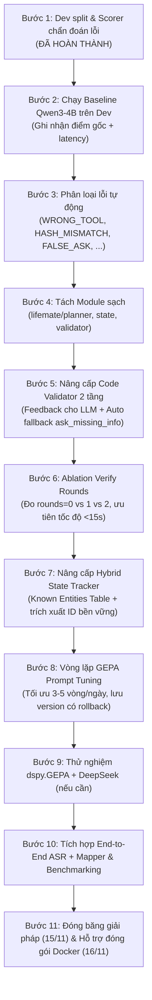

# LifeMate 2026: Tổng Hợp Dự Án, Ràng Buộc Kỹ Thuật và Nhiệm Vụ Của Vương

> Tài liệu tóm tắt toàn diện phục vụ quá trình phát triển của **Vương** trên nhánh `planner/vuong`.  
> Cập nhật: 06/11/2026.

---

## 1. Tổng Quan Dự Án (Project Overview)

### 1.1 Mục Tiêu Cuộc Thi
* **Cuộc thi:** Zalo AI Challenge 2026 – Bảng **LifeMate: Agentic AI That Turns Your Voice Into Action**.
* **Đề bài:** Xây dựng một AI Agent nhận đầu vào là giọng nói tiếng Việt tự nhiên (chứa phương ngữ 3 miền Bắc, Trung, Nam, tiếng Anh pha trộn) cùng ngữ cảnh người dùng, sau đó suy luận và gọi chuỗi công cụ (tool calls) mô phỏng các ứng dụng trong đời sống (nhà thông minh, ngân hàng, gọi xe, đặt món, nhắc việc, lịch hẹn...).
* **Đầu vào (Input):**
  * Spoken audio (`.wav`, 16kHz, mono) của lượt nói hiện tại và các lượt trước trong lịch sử.
  * Context: Thời gian hiện tại, múi giờ, vị trí, hồ sơ người dùng (`user_profile`).
  * Danh sách ứng dụng được cài đặt (`context.installed_apps`) kèm JSON Schema của từng tool.
  * Lịch sử hội thoại (history lên tới 24 lượt).
  * Môi trường mô phỏng (`zaic_tools.ToolEnv`) chứa dữ liệu ban đầu.
* **Đầu ra (Output):**
  * Danh sách có thứ tự các `tool_calls` (`name`, `arguments`).
  * Mã băm trạng thái cuối cùng `state_hash` sinh bởi `env.get_state_hash()`.
  * **3 kịch bản xử lý bắt buộc:**
    1. *Đủ thông tin & Trong phạm vi:* Gọi chuỗi tool đọc/ghi chính xác, đưa app về trạng thái đích.
    2. *Thiếu thông tin:* Gọi `sys.ask_missing_info(tool_name, params)` và dừng ngay sau đó.
    3. *Ngoài phạm vi / Không có app phù hợp / Người dùng tự hủy:* Trả về mảng rỗng `[]`.

---

## 2. Ràng Buộc Kỹ Thuật & Luật Chơi (Constraints & Rules)

| Hạng mục | Ràng buộc chính thức | Ảnh hưởng trực tiếp tới thiết kế |
|---|---|---|
| **Kích thước mô hình** | Tổng toàn hệ thống < 6B params. Riêng LLM < 5B params, context $\le$ 16,384 tokens. | Không được dùng mô hình lớn. Qwen3-4B là lựa chọn tối ưu cho Planner. |
| **Phần cứng chấm điểm** | 1 GPU NVIDIA A30 (24GB VRAM), 16 vCPU, 64GB RAM. | Toàn bộ pipeline (ASR, Mapper, LLM, Verifier) phải nạp vừa vặn trong VRAM. |
| **Thời gian xử lý** | Tối đa **30 giây / mẫu**. Mẫu quá 30s hoặc crash tính **0 điểm**. | Phải kiểm soát chặt chẽ số bước lặp (`MAX_STEPS`), số vòng verify, và độ trễ sinh token. |
| **Môi trường thi đấu** | **Offline 100%**, không có kết nối Internet khi inference; chạy trong Docker container. | Mọi model, checkpoint, thư viện phải đóng gói nội bộ; cấm gọi API bên ngoài lúc test. |
| **Dữ liệu & Truy cập** | Tuyệt đối cấm đọc trực tiếp `state.json` hoặc file trong `<split>_environment/`. Chỉ được tương tác qua `zaic_tools`. | Mọi thông tin trạng thái app phải lấy từ kết quả tool đọc (`read`). |
| **Tính tái lập** | Bắt buộc cố định seed (NumPy, PyTorch, Python), dùng greedy decoding / temperature = 0. | Đảm bảo kết quả deterministic. |
| **Quy tắc chấm điểm** | `state_hash` lệch $\rightarrow$ **0 điểm**. Free-text parameters chấm bằng token-F1 > 0.6. Tool thừa làm giảm Precision. | **Một call ghi thừa làm mất sạch điểm cả mẫu.** Độ an toàn và chính xác của Planner & Validator mang tính sống còn. |
| **Mốc thời gian** | **15/11:** Đóng băng giải pháp. **16/11 23:59:** Nộp Docker. **20/11 - 23/11:** Private Test. | Chỉ có 9 ngày để hoàn thiện và kiểm thử. |

---

## 3. Trách Nhiệm & Module Của Vương (Assigned Scope)

Theo bảng phân công ClickUp và kiến trúc hệ thống, Vương chịu trách nhiệm các module:

```
ZAIC_2026/
├── lifemate/
│   ├── planner/        # Logic lập kế hoạch, prompt Planner, sinh tool_calls
│   ├── state/          # Quản lý Dialogue State, tóm tắt history, quản lý thực thể (ID tracker)
│   └── validator/      # Kiểm tra schema, enum, regex, ID hợp lệ, fallback ask_missing_info
├── eval/
│   └── splits/         # dev_ids.txt (300 mẫu tách theo app)
└── prompts/
    └── gepa/           # Tối ưu hóa prompt Planner bằng GEPA (hợp tác cùng Kiệt)
```

---

## 4. Những Việc Đang và Sẽ Làm (Our Doing & Roadmap)

### 4.1 Các Quyết Định Kiến Trúc Đã Chốt (Decisions D1 - D6)
1. **D1 (Kế thừa Baseline):** Bắt đầu từ file `lifemate/pipeline.py` đang chạy tốt. Tách dần Planner, State, Validator sang module riêng biệt mà không làm đổi hành vi, sau đó cải tiến từng phần có đo đạc (A/B testing).
2. **D2 (Môi trường & Scorer):** Đã kiểm tra replay nhãn gold đạt điểm tuyệt đối 1.0 trên `zaic_tools`.
3. **D3 (Môi trường GPU):** Máy local (RTX 4060 8GB) dùng để code, chạy unit test, replay gold, và test mô hình nhỏ. Các lượt đánh giá Qwen3-4B đầy đủ (bf16, vLLM) chạy trên Cloud GPU (Kaggle/Colab/lab A30).
4. **D4 (Held-out Dev Split):** Đã tạo `eval/splits/dev_ids.txt` gồm **300 mẫu** (19.4% train) với cơ chế **Hybrid Split**: giữ lại hoàn toàn **9 app lạ** (20% số app trong train) để kiểm tra zero-shot, kết hợp phân tầng chuẩn xác tỉ lệ `act` (78.7%), `ask` (14.0%), `empty` (7.3%).
5. **D5 (Tách biệt thử nghiệm):** Tối ưu Planner bằng chế độ `--text` (sử dụng text gốc) để đo lường thuần túy khả năng suy luận; chạy kiểm tra end-to-end với ASR + Mapper trước khi đóng băng.
6. **D6 (Quy trình GEPA):** Thực hiện chu trình **Manual GEPA** trực tiếp trong chat: agent đóng vai trò Reflection LLM phân tích trace lỗi, đề xuất tinh chỉnh prompt/validator, chỉ giữ thay đổi nếu dev F1 tăng.

---

### 4.2 Lộ Trình Triển Khai 11 Bước Chi Tiết



#### Chi tiết tiến độ:
* **Bước 1 (Đã xong):** Sinh `eval/splits/dev_ids.txt` (300 mẫu) và viết `eval/scorer.py` hỗ trợ chấm điểm và phân loại lỗi chi tiết.
* **Bước 2 (Tiếp theo):** Chạy `lifemate/pipeline.py --text` trên tập 300 mẫu dev bằng Qwen3-4B để lấy baseline score đầu tiên.
* **Bước 3:** Sử dụng `eval/scorer.py` sinh báo cáo chẩn đoán nhóm lỗi (bảng phân phối lỗi % trên dev).
* **Bước 4:** Chuyển các hàm `plan_step`, `SYSTEM` sang `lifemate/planner/`; `build_messages`, context clipping sang `lifemate/state/`; `unseen_ids` sang `lifemate/validator/`. Chạy regression test đảm bảo điểm số giữ nguyên.
* **Bước 5:** Bổ sung quy tắc trong Validator: bắt lỗi thiếu tham số bắt buộc / x-one-of / sai định dạng ISO datetime $\rightarrow$ tự động chuyển hóa thành `sys.ask_missing_info` an toàn, cứu điểm cho các trường hợp LLM bế tắc.
* **Bước 6:** Thử nghiệm `--verify-rounds 0` vs `1` vs `2`, chọn cấu hình cân bằng tối ưu giữa độ chính xác và thời gian chạy.
* **Bước 7:** Xây dựng bảng trích xuất thực thể bền vững (`Known Entities`) trong `lifemate/state/` để không bao giờ bị mất ID quan trọng khi cắt tỉa lịch sử hội thoại dài.
* **Bước 8:** Lặp chu trình phản tư (Reflection) trên các mẫu thất bại, hoàn thiện các phiên bản prompt tại `prompts/gepa/system_v{N}.txt`.
* **Bước 10 - 11:** Kiểm tra toàn diện, bàn giao cho Tiến đóng Docker trước hạn chót 16/11.
