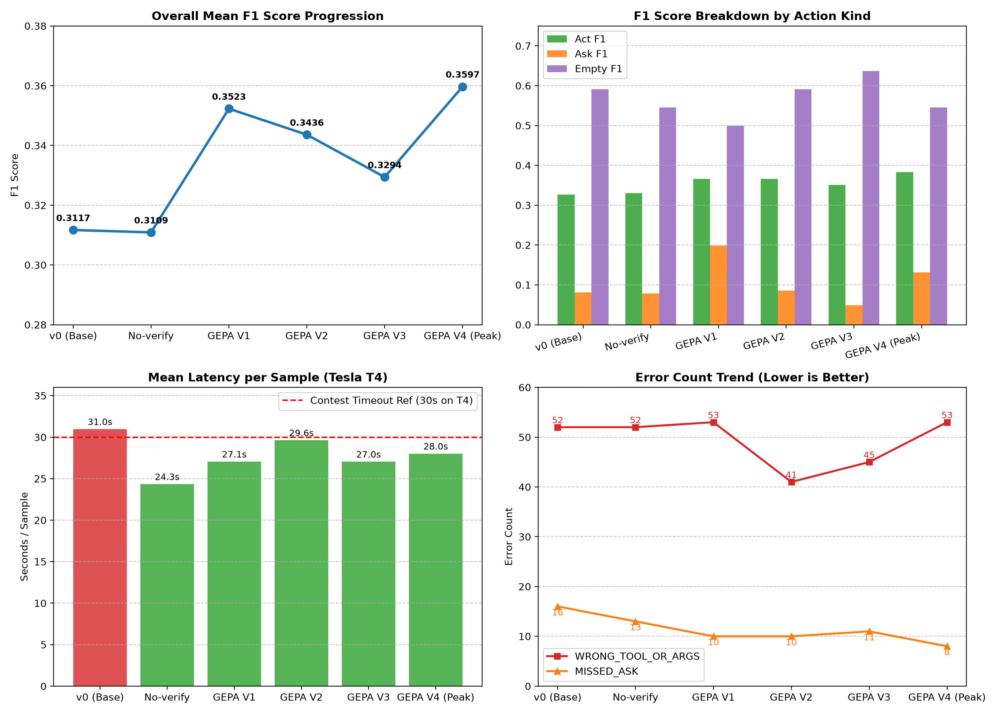
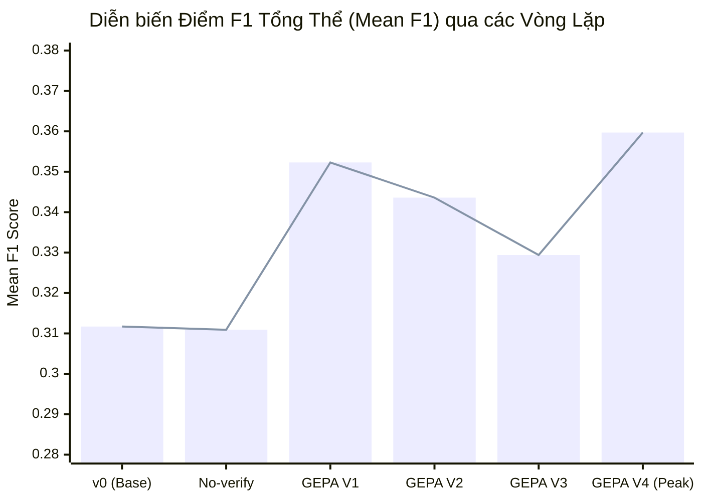
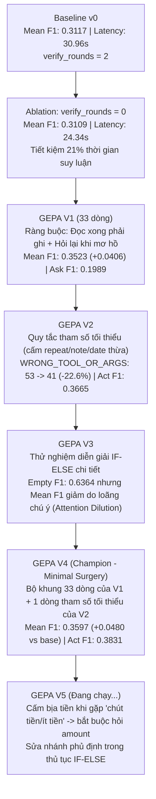

# Báo cáo kết quả tối ưu Prompt GEPA (Vương)

Tài liệu tổng hợp số liệu đo lường, biểu đồ tiến trình và phân tích lỗi chi tiết qua các vòng lặp GEPA (V0 $\rightarrow$ V4 và chuẩn bị V5) trên tập **300 mẫu dev (`eval/splits/dev_ids.txt`)** bằng model **`Qwen/Qwen3-4B-Instruct-2507`**.

---

## 1. Biểu đồ tổng quan tiến trình (Benchmark Plots)

---

## 2. Bảng so sánh điểm số chi tiết qua các phiên bản (`eval/scorer.py`)

| Phiên bản | Prompt File | Mean F1 | Act F1 (n=236) | Ask F1 (n=42) | Empty F1 (n=22) | Độ trễ TB | Trạng thái |
| :--- | :--- | :---: | :---: | :---: | :---: | :---: | :--- |
| **Baseline v0** | `planner_v0.txt` | 0.3117 | 0.3268 | 0.0810 | 0.5909 | 30.96s | Mốc chuẩn ban đầu |
| **Ablation (no-verify)** | `planner_v0.txt` | 0.3109 | 0.3304 | 0.0786 | 0.5455 | 24.34s | Giảm ~6.6s độ trễ |
| **GEPA Iter 1** | `planner_v1.txt` | 0.3523 | 0.3659 | **0.1989** 🔥 | 0.5000 | 27.05s | Bứt phá Ask F1 (+145%) |
| **GEPA Iter 2** | `planner_v2.txt` | 0.3436 | 0.3665 | 0.0854 | 0.5909 | 29.62s | Giảm 22.6% lỗi tham số |
| **GEPA Iter 3** | `planner_v3.txt` | 0.3294 | 0.3507 | 0.0492 | **0.6364** 🏆 | 27.04s | Empty F1 cao nhất |
| **GEPA Iter 4 (Champion)** | `planner_v4.txt` | **0.3597** 🥇 | **0.3831** 🚀 | 0.1314 | 0.5455 | 28.01s | **Đỉnh F1 & Act cao nhất** |
| **GEPA Iter 5** | `planner_v5.txt` | *Đang chạy...* | *...* | *...* | *...* | *...* | Sửa từ mập mờ & IF-ELSE |

---

## 3. Bảng phân loại lỗi chi tiết (Diagnostic Error Breakdown)

| Phiên bản | HASH MISMATCH | WRONG TOOL/ARGS | MISSED ASK | MISSING CALL | FALSE ACT | EXTRA CALL | FALSE ASK |
| :--- | :---: | :---: | :---: | :---: | :---: | :---: | :---: |
| **Baseline v0** | 139 (46.3%) | 52 (17.3%) | 16 (5.3%) | 12 (4.0%) | 9 (3.0%) | 4 (1.3%) | 0 (0.0%) |
| **No-verify** | 140 (46.7%) | 52 (17.3%) | 13 (4.3%) | 12 (4.0%) | 10 (3.3%) | 5 (1.7%) | 1 (0.3%) |
| **GEPA V1** | 129 (43.0%) | 53 (17.7%) | 10 (3.3%) | 16 (5.3%) | 11 (3.7%) | 6 (2.0%) | 2 (0.7%) |
| **GEPA V2** | 140 (46.7%) | **41 (13.7%)** | 10 (3.3%) | 15 (5.0%) | 9 (3.0%) | 7 (2.3%) | 2 (0.7%) |
| **GEPA V3** | 144 (48.0%) | 45 (15.0%) | 11 (3.7%) | 11 (3.7%) | **8 (2.7%)** | **2 (0.7%)** | 2 (0.7%) |
| **GEPA V4** | **132 (44.0%)** | 53 (17.7%) | **8 (2.7%)** | 16 (5.3%) | 10 (3.3%) | 5 (1.7%) | **1 (0.3%)** |

---

## 4. Cây đột biến Prompt và Bài học then chốt (Mutation Tree)

---

## 5. Tổng kết quy luật và hướng đi tiếp theo:
1. **Quy luật tinh gọn cho Model 4B (Minimal Surgery)**: Mô hình Qwen3-4B-Instruct đạt hiệu năng cao nhất với prompt ngắn (khoảng 30-34 dòng). Mọi nỗ lực giải thích quá dài dòng bằng văn phong tự nhiên đều gây phản tác dụng do loãng chú ý.
2. **Quy tắc Tham số tối thiểu**: Đã chứng minh giá trị lớn nhất trong việc giảm lỗi `WRONG_TOOL_OR_ARGS` từ 53 về 41.
3. **Quy tắc Chống tự bịa tham số mập mờ**: Là vũ khí tiếp theo trong V5 để giảm 132 lỗi `HASH_MISMATCH`.
