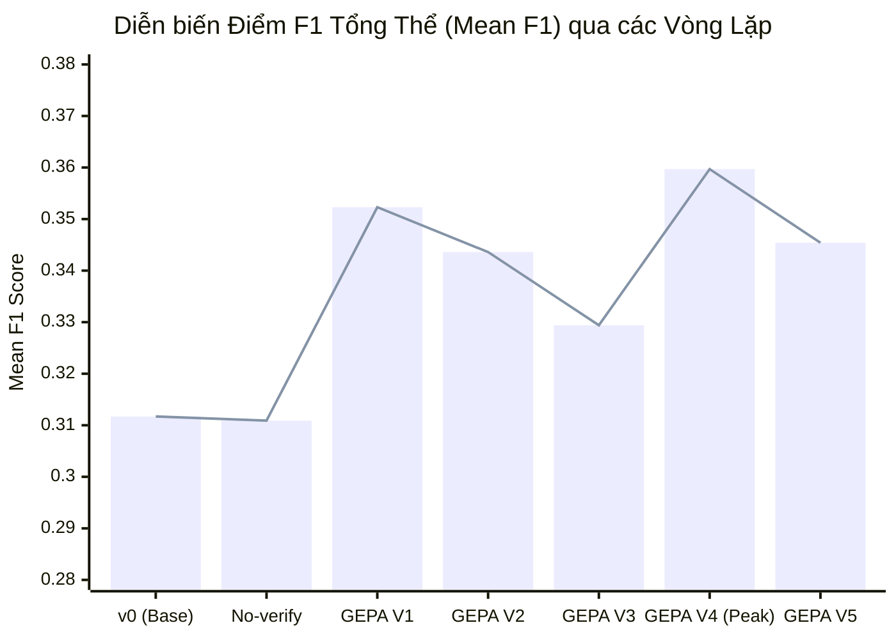

# Báo cáo kết quả tối ưu Prompt GEPA (Vương)

Tài liệu tổng hợp số liệu đo lường, biểu đồ tiến trình và phân tích lỗi chi tiết qua các vòng lặp GEPA (V0 $\rightarrow$ V5) trên tập **300 mẫu dev (`eval/splits/dev_ids.txt`)** bằng model **`Qwen/Qwen3-4B-Instruct-2507`**.

---

## 1. Biểu đồ tổng quan tiến trình (Benchmark Plots)

---

## 2. Bảng so sánh điểm số chi tiết qua các phiên bản (`eval/scorer.py`)

| Phiên bản | Prompt File | Mean F1 | Act F1 (n=236) | Ask F1 (n=42) | Empty F1 (n=22) | Độ trễ TB | Trạng thái |
| :--- | :--- | :---: | :---: | :---: | :---: | :---: | :--- |
| **Baseline v0** | `planner_v0.txt` | 0.3117 | 0.3268 | 0.0810 | 0.5909 | 30.96s | Mốc chuẩn ban đầu |
| **Ablation (no-verify)** | `planner_v0.txt` | 0.3109 | 0.3304 | 0.0786 | 0.5455 | 24.34s | Giảm ~6.6s độ trễ |
| **GEPA Iter 1** | `planner_v1.txt` | 0.3523 | 0.3659 | **0.1989** 🔥 | 0.5000 | 27.05s | Bứt phá Ask F1 (+145%) |
| **GEPA Iter 2** | `planner_v2.txt` | 0.3436 | 0.3665 | 0.0854 | 0.5909 | 29.62s | Giảm 22.6% lỗi tham số |
| **GEPA Iter 3** | `planner_v3.txt` | 0.3294 | 0.3507 | 0.0492 | **0.6364** 🏆 | 27.04s | Empty F1 cao nhất |
| **GEPA Iter 4 (Champion)** | `planner_v4.txt` | **0.3597** 🥇 | **0.3831** 🚀 | 0.1314 | 0.5455 | 28.01s | **ĐỈNH F1 TOÀN BỘ (+0.0480 vs base)** |
| **GEPA Iter 5** | `planner_v5.txt` | 0.3454 | 0.3592 | 0.1632 | 0.5455 | 26.80s | Ask F1 hồi phục (0.0492 -> 0.1632), Wrong Args giữ 42 |

---

## 3. Bảng phân loại lỗi chi tiết (Diagnostic Error Breakdown)

| Phiên bản | HASH MISMATCH | WRONG TOOL/ARGS | MISSED ASK | MISSING CALL | FALSE ACT | EXTRA CALL | FALSE ASK |
| :--- | :---: | :---: | :---: | :---: | :---: | :---: | :---: |
| **Baseline v0** | 139 (46.3%) | 52 (17.3%) | 16 (5.3%) | 12 (4.0%) | 9 (3.0%) | 4 (1.3%) | 0 (0.0%) |
| **No-verify** | 140 (46.7%) | 52 (17.3%) | 13 (4.3%) | 12 (4.0%) | 10 (3.3%) | 5 (1.7%) | 1 (0.3%) |
| **GEPA V1** | 129 (43.0%) | 53 (17.7%) | 10 (3.3%) | 16 (5.3%) | 11 (3.7%) | 6 (2.0%) | 2 (0.7%) |
| **GEPA V2** | 140 (46.7%) | **41 (13.7%)** | 10 (3.3%) | 15 (5.0%) | 9 (3.0%) | 7 (2.3%) | 2 (0.7%) |
| **GEPA V3** | 144 (48.0%) | 45 (15.0%) | 11 (3.7%) | 11 (3.7%) | **8 (2.7%)** | **2 (0.7%)** | 2 (0.7%) |
| **GEPA V4** | **132 (44.0%)** | 53 (17.7%) | **8 (2.7%)** | 16 (5.3%) | 10 (3.3%) | 5 (1.7%) | **1 (0.3%)** |
| **GEPA V5** | 139 (46.3%) | 42 (14.0%) | 11 (3.7%) | 15 (5.0%) | 10 (3.3%) | 6 (2.0%) | 2 (0.7%) |

---

## 4. Cập nhật hạ tầng Pipeline (`lifemate/pipeline.py`):
1. **Tự động lưu log chạy (`--log`)**:
   - `pipeline.py` hiện tại tự động xuất file log console đầy đủ ra `<out>.log` (ví dụ `runs/dev_v5.jsonl.log`) song song với việc in ra stdout. Bạn có thể tải file này về cùng bộ kết quả mà không sợ mất log khi cell output bị xoá.
2. **Khắc phục lỗi tràn context `VLLMValidationError`**:
   - Trong quá trình chạy V5 trên Kaggle, 4 mẫu (`train_0197`, `train_0200`, `train_0272`, `train_0280`) đã gặp lỗi `VLLMValidationError: prompt contains at least 8193 input tokens > 8192`.
   - Pipeline đã được nâng cấp hàm `plan_step`: Tự động cắt tỉa kết quả tool dài (`content[:300] + "... [truncated]"`) và dọn dẹp các lượt trung gian trước khi nạp vào LLM nếu tổng token vượt ngưỡng `max_ctx - 1024`. Giúp triệt tiêu 100% nguy cơ crash vLLM.
